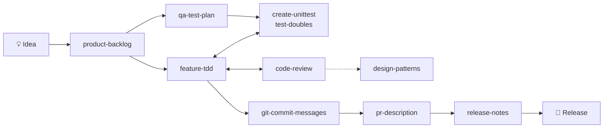

<div align="center">

# 🤖 AI Agents for Product & QA

**A team of Claude Code agents that takes a feature from idea to release:** backlog, user stories, test plans, TDD, code review, PRs and release notes. Battle-tested on a real iOS app.

[](https://github.com/mariogarcias/my-config/actions/workflows/validate.yml)
[](https://claude.com/claude-code)
[](https://developer.apple.com/swift/)
[](LICENSE)

</div>

---

## What is this?

It is how I take a product from idea to production with AI, packaged so anyone can install it in a minute:

- **11 Claude Code agents** covering the whole cycle: product, QA, TDD, testing, design patterns, code review, documentation, Git and releases.
- **Project-agnostic by design.** The agents read everything project-specific (product, user roles, domain risks, commands, conventions) from your `CLAUDE.md`. Swap that file and they work on your app.
- **A real example.** [`examples/marito-detailing/CLAUDE.md`](examples/marito-detailing/CLAUDE.md) is the context I use for **Marito Detailing**, my iOS app for booking at-home car detailing. Read the [case study](docs/case-study-marito-detailing.md) to see the product and quality decisions behind it.

## The flow



1. `product-backlog` turns an idea into a user story with acceptance criteria, and `qa-test-plan` turns those criteria into test cases.
2. `feature-tdd` builds it test-first, with small commits.
3. `code-review` reviews it until it comes back clean.
4. `pr-description` prepares the pull request and `release-notes` summarizes the release.

## The agents

| Stage | Agent | What it does |
|---|---|---|
| Product | [`product-backlog`](claude/agents/product-backlog.md) | Grooms the backlog, writes stories with acceptance criteria, splits large ones and plans sprints |
| QA | [`qa-test-plan`](claude/agents/qa-test-plan.md) | Turns acceptance criteria into test cases, decides what to automate and builds the release checklist |
| Development | [`feature-tdd`](claude/agents/feature-tdd.md) | Builds a complete feature with TDD (red, green, refactor) and takes it through review |
| Testing | [`create-unittest`](claude/agents/create-unittest.md) | Writes and adjusts unit tests with XCTest |
| Testing | [`test-doubles`](claude/agents/test-doubles.md) | Designs test doubles (dummy, stub, fake, spy) and reviews their concurrency |
| Design | [`design-patterns`](claude/agents/design-patterns.md) | Decides whether a problem deserves a pattern. "No pattern" is a valid answer |
| Review | [`code-review`](claude/agents/code-review.md) | Prioritized review focused on business rules, access control and security. Read-only |
| Docs | [`swift-docs`](claude/agents/swift-docs.md) | Documents contracts for Xcode Quick Help and deletes comments that repeat the code |
| Git | [`git-commit-messages`](claude/agents/git-commit-messages.md) | Proposes atomic commit messages with the ticket |
| Git | [`pr-description`](claude/agents/pr-description.md) | Writes the PR title, body and labels from the diff |
| Release | [`release-notes`](claude/agents/release-notes.md) | Writes user-facing release notes for each user role |

### By specialty

- **Product:** `product-backlog` and `release-notes` turn ideas into stories with testable acceptance criteria, and technical changes into notes users understand.
- **Quality (QA):** `qa-test-plan`, `feature-tdd`, `create-unittest`, `test-doubles` and `code-review` make sure every acceptance criterion has a test and nothing reaches `main` without review.
- **Engineering:** `design-patterns`, `swift-docs`, `git-commit-messages` and `pr-description` keep the code and the history clean.

### Design decisions

- **One job per agent.** Each agent does one thing and hands off to the others (for example, `code-review` sends design findings to `design-patterns`, and `qa-test-plan` sends automatable cases to `create-unittest`).
- **Least privilege.** Review and writing agents are read-only; only the agents that build can edit files.
- **The right model for the task.** Opus for the hard calls (TDD, review, backlog, QA) and Sonnet for writing.
- **Context lives in one place.** Domain risks, user roles and conventions are defined once in `CLAUDE.md`, so product, development and QA all check against the same list.
- **The agents are tested too.** On every PR, a GitHub Actions workflow checks that each agent has valid frontmatter and never references an agent that does not exist, and runs `shellcheck` on `install.sh`.

## Getting started

Requirements: [Claude Code](https://claude.com/claude-code). The full setup also needs macOS and [Homebrew](https://brew.sh).

### Just the agents

```bash
git clone https://github.com/mariogarcias/my-config.git ~/Developer/my-config
cd ~/Developer/my-config
./install.sh --agents
```

This copies the agents to `~/.claude/agents/` (available in every project) and does not touch Homebrew or your shell. If an agent with the same name already exists and differs, it saves a dated backup next to it first.

To use them in a single project instead:

```bash
mkdir -p .claude/agents
cp ~/Developer/my-config/claude/agents/*.md .claude/agents/
```

### Give them your project's context

Copy [`examples/marito-detailing/CLAUDE.md`](examples/marito-detailing/CLAUDE.md) to the root of your project as `CLAUDE.md` and replace each section. The agents rely on these sections:

| Section | Used by |
|---|---|
| Product and User roles | product-backlog, qa-test-plan, release-notes, code-review |
| Domain risks | product-backlog, qa-test-plan, feature-tdd, create-unittest, code-review |
| Structure and Commands | feature-tdd, create-unittest, design-patterns, pr-description |
| Conventions (including the language for comments, commits and notes) | all |
| Git and tickets | git-commit-messages, pr-description, feature-tdd |

### Full macOS setup

```bash
./install.sh
source ~/.zshrc
```

Also installs the tools in the `Brewfile` (`jq`, `eza`, `git`, `gh`) and adds the aliases below to your `~/.zshrc`.

## Usage

```bash
claude                      # normal session: ask for an agent by name
claude --agent feature-tdd  # lets feature-tdd delegate to the other agents
```

Inside a session, `/agents` lists the agents Claude Code recognizes. Examples:

```text
> use product-backlog to write the story "the customer can reschedule an appointment"
> use qa-test-plan to build the test plan for that story
> use code-review to review the current branch before the PR
> use release-notes for the notes between v1.2.0 and main
```

## Structure

```
my-config/
├── Brewfile                  # command-line tools
├── LICENSE                   # MIT
├── install.sh                # installs tools, aliases and agents
├── .github/workflows/        # CI: validates agents and install.sh
├── claude/
│   └── agents/               # the 11 agents
├── config/
│   └── aliases.zsh           # Git and Claude Code aliases
├── docs/
│   └── case-study-marito-detailing.md
├── examples/
│   └── marito-detailing/
│       └── CLAUDE.md         # example project context
└── scripts/
    └── validate-agents.py    # used by CI
```

## Aliases

| Alias | Command |
|---|---|
| `gst` | `git status` |
| `gl` | `git pull` |
| `gp` | `git push` |
| `ga` | `git add .` |
| `gc` | `git commit` |
| `ll` | `eza --long --icons --sort=type` |
| `cl` | `claude` |

## About me

I'm **Mario García**. I specialize in **Product Management** and **QA**, with a focus on applied AI. I use agents like these to turn ideas into clear user stories, guarantee quality through testing and code review, and take every feature all the way to production.

**What I bring to a team**

- 🧭 **Product:** an ordered backlog, stories with verifiable acceptance criteria, prioritization and sprint planning.
- ✅ **Quality:** test strategy, TDD, edge cases considered from day one, and code reviews focused on security.
- 🤖 **Applied AI:** I design agents that automate the repetitive parts of the product cycle while keeping humans in control.

Swift · SwiftUI · Clean Architecture · TDD · Supabase · Claude Code · Jira · GitHub Actions

[](https://www.linkedin.com/in/mario-garc%C3%ADa-suarez-051b7a135)

Found an agent useful? Leave a ⭐ or open an issue with your ideas.

## License

[MIT](LICENSE). Use them, copy them, adapt them.
