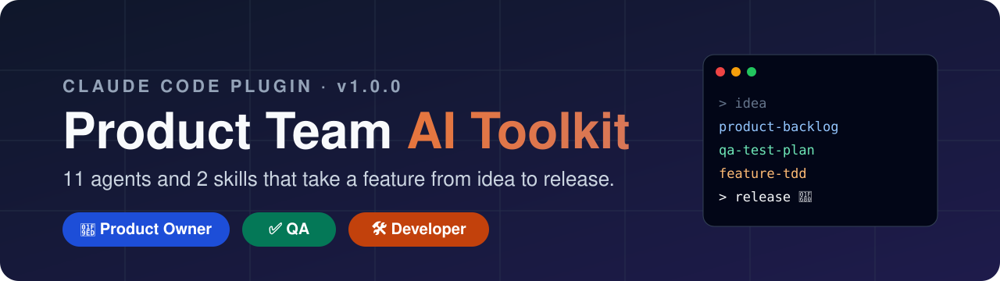
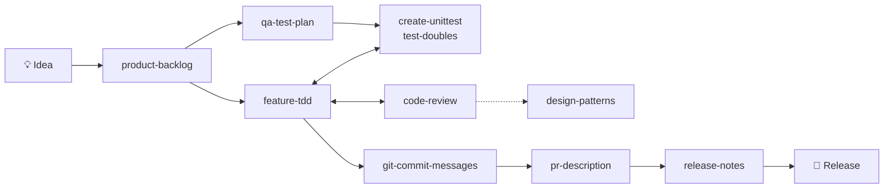

<div align="center">



**AI agents and skills for the whole product team.** Developers, QA and Product Owners each get Claude Code tools for their part of the job, and they hand work to each other from idea to release. Battle-tested on a real iOS app.

[](https://github.com/mariogarcias/product-team-ai-toolkit/actions/workflows/validate.yml)
[](https://claude.com/claude-code)
[](CHANGELOG.md)
[](#install-as-a-plugin-recommended)
[](LICENSE)

**[See a real feature go from idea to release →](examples/marito-detailing/walkthrough.md)**

</div>

---

## Who is it for?

| If you are a… | Use it to… | Start with |
|---|---|---|
| **Product Owner / Product Manager** | Turn ideas into stories with testable acceptance criteria, prioritize the backlog, plan sprints and write release notes users understand | `product-backlog`, `release-notes`, the `acceptance-criteria` skill |
| **QA** | Turn acceptance criteria into test plans with traceability, decide what to automate, file reproducible bugs and run release regressions | `qa-test-plan`, `code-review`, the `bug-report` skill |
| **Developer** | Build features test-first, design test doubles, get a prioritized review, and write commits and PR descriptions | `feature-tdd`, `create-unittest`, `test-doubles`, `pr-description` |

The tools share one context file and hand off to each other, so the story the Product Owner writes is the same one QA tests and the developer builds.

## See it in action

The [walkthrough](examples/marito-detailing/walkthrough.md) follows one real feature, "a customer reschedules an appointment", through six agents:

| Step | Agent | Output |
|---|---|---|
| 1 | `product-backlog` | A user story with 5 testable acceptance criteria and its edge cases |
| 2 | `qa-test-plan` | 7 test cases traced to those criteria, 6 of them handed to automation |
| 3 | `feature-tdd` | The feature built test-first, one commit per cycle |
| 4 | `code-review` | A security blocker in the database access policy, caught before merge |
| 5 | `pr-description` | A PR body with use cases, migration notes and test steps |
| 6 | `release-notes` | Notes a customer understands, with no jargon |

## What is inside?

It is how I take a product from idea to production with AI, packaged so anyone can install it in a minute:

- **11 Claude Code agents** covering the whole cycle: product, QA, TDD, testing, design patterns, code review, documentation, Git and releases.
- **Project-agnostic by design.** The agents read everything project-specific (product, user roles, domain risks, commands, conventions) from your `CLAUDE.md`. Swap that file and they work on your app.
- **2 skills** that Claude uses on its own when it needs them: testable acceptance criteria and reproducible bug reports.
- **Product and QA templates** for user stories, test plans and bug reports, ready to copy into your tracker.
- **A real example.** [`examples/marito-detailing/CLAUDE.md`](examples/marito-detailing/CLAUDE.md) is the context I use for **Marito Detailing**, my iOS app for booking at-home car detailing. Read the [case study](docs/case-study-marito-detailing.md) to see the product and quality decisions behind it.

## The flow



1. `product-backlog` turns an idea into a user story with acceptance criteria, and `qa-test-plan` turns those criteria into test cases.
2. `feature-tdd` builds it test-first, with small commits.
3. `code-review` reviews it until it comes back clean.
4. `pr-description` prepares the pull request and `release-notes` summarizes the release.

## The agents

| Stage | Agent | What it does |
|---|---|---|
| Product | [`product-backlog`](agents/product-backlog.md) | Grooms the backlog, writes stories with acceptance criteria, splits large ones and plans sprints |
| QA | [`qa-test-plan`](agents/qa-test-plan.md) | Turns acceptance criteria into test cases, decides what to automate and builds the release checklist |
| Development | [`feature-tdd`](agents/feature-tdd.md) | Builds a complete feature with TDD (red, green, refactor) and takes it through review |
| Testing | [`create-unittest`](agents/create-unittest.md) | Writes and adjusts unit tests with XCTest |
| Testing | [`test-doubles`](agents/test-doubles.md) | Designs test doubles (dummy, stub, fake, spy) and reviews their concurrency |
| Design | [`design-patterns`](agents/design-patterns.md) | Decides whether a problem deserves a pattern. "No pattern" is a valid answer |
| Review | [`code-review`](agents/code-review.md) | Prioritized review focused on business rules, access control and security. Read-only |
| Docs | [`swift-docs`](agents/swift-docs.md) | Documents contracts for Xcode Quick Help and deletes comments that repeat the code |
| Git | [`git-commit-messages`](agents/git-commit-messages.md) | Proposes atomic commit messages with the ticket |
| Git | [`pr-description`](agents/pr-description.md) | Writes the PR title, body and labels from the diff |
| Release | [`release-notes`](agents/release-notes.md) | Writes user-facing release notes for each user role |

## The skills

Agents are teammates you call for a whole job. Skills are short recipes Claude picks up automatically when a task needs them, inside any conversation.

| Skill | When Claude uses it |
|---|---|
| [`acceptance-criteria`](skills/acceptance-criteria/SKILL.md) | A story or ticket needs acceptance criteria, or you ask whether one is ready. Writes Given / When / Then criteria and turns vague words into measurable ones |
| [`bug-report`](skills/bug-report/SKILL.md) | Something is broken, an error is pasted, or you ask to file a bug. Produces a report with severity, environment and exact steps to reproduce |

### By specialty

- **Product:** `product-backlog` and `release-notes` turn ideas into stories with testable acceptance criteria, and technical changes into notes users understand.
- **Quality (QA):** `qa-test-plan`, `feature-tdd`, `create-unittest`, `test-doubles` and `code-review` make sure every acceptance criterion has a test and nothing reaches `main` without review.
- **Engineering:** `design-patterns`, `swift-docs`, `git-commit-messages` and `pr-description` keep the code and the history clean.

### Design decisions

- **One job per agent.** Each agent does one thing and hands off to the others (for example, `code-review` sends design findings to `design-patterns`, and `qa-test-plan` sends automatable cases to `create-unittest`).
- **Least privilege.** Review and writing agents are read-only; only the agents that build can edit files.
- **The right model for the task.** Opus for the hard calls (TDD, review, backlog, QA) and Sonnet for writing.
- **Context lives in one place.** Domain risks, user roles and conventions are defined once in `CLAUDE.md`, so product, development and QA all check against the same list.
- **The agents are tested too.** On every PR, a GitHub Actions workflow checks that each agent has valid frontmatter and never references an agent that does not exist, and runs `shellcheck` on `install.sh`.

## Getting started

Requirements: [Claude Code](https://claude.com/claude-code).

### Install as a plugin (recommended)

Inside Claude Code, run:

```text
/plugin install product-team-ai-toolkit --marketplace mariogarcias/product-team-ai-toolkit
```

On Claude Code versions older than 2.1.275, add the marketplace first and then install:

```text
/plugin marketplace add mariogarcias/product-team-ai-toolkit
/plugin install product-team-ai-toolkit@mariogarcias
```

You get all 11 agents and both skills, and future updates with `/plugin update`. Plugin agents are namespaced, so they show up as `product-team-ai-toolkit:qa-test-plan` and so on.

### Install by copying the files

```bash
git clone https://github.com/mariogarcias/product-team-ai-toolkit.git ~/Developer/product-team-ai-toolkit
cd ~/Developer/product-team-ai-toolkit
./install.sh --agents
```

This copies the agents to `~/.claude/agents/` and the skills to `~/.claude/skills/` (available in every project) and does not touch Homebrew or your shell. If an agent with the same name already exists and differs, it saves a dated backup next to it first.

To use them in a single project instead:

```bash
mkdir -p .claude/agents
cp ~/Developer/product-team-ai-toolkit/agents/*.md .claude/agents/
```

### Give them your project's context

Copy [`examples/marito-detailing/CLAUDE.md`](examples/marito-detailing/CLAUDE.md) to the root of your project as `CLAUDE.md` and replace each section. The agents rely on these sections:

| Section | Used by |
|---|---|
| Product and User roles | product-backlog, qa-test-plan, release-notes, code-review |
| Domain risks | product-backlog, qa-test-plan, feature-tdd, create-unittest, code-review |
| Structure and Commands | feature-tdd, create-unittest, design-patterns, pr-description |
| Conventions (including the language for comments, commits and notes) | all |
| Git and tickets | git-commit-messages, pr-description, feature-tdd |

### Full macOS setup

`./install.sh` without flags also installs my command-line tools and shell aliases. See [docs/dotfiles.md](docs/dotfiles.md).

## Usage

```bash
claude                      # normal session: ask for an agent by name
claude --agent feature-tdd  # lets feature-tdd delegate to the other agents
```

Inside a session, `/agents` lists the agents Claude Code recognizes. Examples:

```text
> use product-backlog to write the story "the customer can reschedule an appointment"
> use qa-test-plan to build the test plan for that story
> use code-review to review the current branch before the PR
> use release-notes for the notes between v1.2.0 and main
```

## Roadmap

- [x] 11 agents and 2 skills, packaged as a Claude Code plugin
- [x] Project-agnostic context through `CLAUDE.md`
- [x] CI that validates every agent and skill
- [ ] `prd-writer` agent: from a problem statement to a one-page PRD with success metrics
- [ ] `accessibility-audit` agent: VoiceOver, Dynamic Type and contrast checks against WCAG
- [ ] `regression-plan` skill: pick the regression suite for a release from the diff
- [ ] Context examples for a web app and an API, not only iOS

## Templates

| Template | What it is for |
|---|---|
| [User story](templates/user-story.md) | Story with Given / When / Then acceptance criteria, edge cases and a definition of ready |
| [Test plan](templates/test-plan.md) | Traceability matrix, test cases with priority and automation decision, exit checklist |
| [Bug report](templates/bug-report.md) | Severity scale, environment, steps to reproduce, expected vs. actual result |

This repo uses them too: every pull request follows a [template](.github/pull_request_template.md).

## Structure

```
product-team-ai-toolkit/
├── Brewfile                  # command-line tools
├── LICENSE                   # MIT
├── install.sh                # installs tools, aliases, agents and skills
├── .claude-plugin/           # plugin and marketplace manifests
├── .github/                  # CI and PR template
├── agents/                   # the 11 agents
├── CHANGELOG.md
├── SECURITY.md
├── assets/                   # banner
├── config/
│   └── aliases.zsh           # Git and Claude Code aliases
├── docs/
│   ├── case-study-marito-detailing.md
│   └── dotfiles.md           # my macOS setup and aliases
├── examples/
│   └── marito-detailing/
│       ├── CLAUDE.md         # example project context
│       └── walkthrough.md    # one feature, idea to release
├── scripts/
│   └── validate.py           # used by CI
├── skills/                   # the 2 skills
└── templates/                # user story, test plan, bug report
```

## About me

I'm **Mario García**. I specialize in **Product Management** and **QA**, with a focus on applied AI. I use agents like these to turn ideas into clear user stories, guarantee quality through testing and code review, and take every feature all the way to production.

**What I bring to a team**

- 🧭 **Product:** an ordered backlog, stories with verifiable acceptance criteria, prioritization and sprint planning.
- ✅ **Quality:** test strategy, TDD, edge cases considered from day one, and code reviews focused on security.
- 🤖 **Applied AI:** I design agents that automate the repetitive parts of the product cycle while keeping humans in control.

Swift · SwiftUI · Clean Architecture · TDD · Supabase · Claude Code · Jira · GitHub Actions

[](https://www.linkedin.com/in/mario-garc%C3%ADa-suarez-051b7a135)

Found an agent useful? Leave a ⭐ or tell me about it on LinkedIn.

## License

[MIT](LICENSE). Use them, copy them, adapt them.
