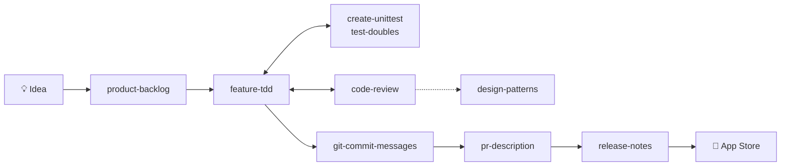

<div align="center">

# 🤖 Agentes de Claude Code para iOS

**Un equipo de agentes de IA que lleva una feature de iOS de la idea al release:** backlog, TDD, revisión de código, PR y notas de versión.

[](https://claude.com/claude-code)
[](https://developer.apple.com/swift/)
[](https://supabase.com)
[](#instalación)
[](LICENSE)

</div>

---

## ¿Qué es esto?

Es mi forma de trabajar como desarrollador iOS, empaquetada para que cualquiera la instale en un minuto:

- **10 agentes de Claude Code** especializados en el ciclo de desarrollo iOS: producto, TDD, pruebas, patrones de diseño, revisión, documentación, Git y releases.
- **Un `CLAUDE.md` de ejemplo** que muestra cómo dar contexto de proyecto a Claude (stack, arquitectura, convenciones y reglas de seguridad).
- **Mi setup de terminal en macOS**: herramientas con Homebrew y aliases.

Los uso a diario en **Marito Detailing**, mi app iOS para reservar servicios de detailing de autos a domicilio (SwiftUI, Clean Architecture, Supabase y XCTest).

## El flujo



1. `product-backlog` convierte una idea en una historia de usuario con criterios de aceptación.
2. `feature-tdd` la construye con pruebas primero y commits pequeños.
3. `code-review` la revisa hasta que queda limpia.
4. `pr-description` prepara el Pull Request y `release-notes` resume la versión.

## Los agentes

| Etapa | Agente | Qué hace |
|---|---|---|
| Producto | [`product-backlog`](claude/agents/product-backlog.md) | Ordena el backlog, escribe historias con criterios de aceptación, parte las grandes y planea sprints |
| Desarrollo | [`feature-tdd`](claude/agents/feature-tdd.md) | Construye una feature completa con TDD (rojo, verde, refactor) y la pasa por revisión |
| Pruebas | [`create-unittest`](claude/agents/create-unittest.md) | Escribe y ajusta pruebas unitarias con XCTest |
| Pruebas | [`test-doubles`](claude/agents/test-doubles.md) | Diseña dobles de prueba (dummy, stub, fake, spy) y revisa su concurrencia |
| Diseño | [`design-patterns`](claude/agents/design-patterns.md) | Decide si un problema merece un patrón. "Ningún patrón" es una respuesta válida |
| Revisión | [`code-review`](claude/agents/code-review.md) | Revisión priorizada con foco en arquitectura, Supabase y seguridad. Solo lectura |
| Documentación | [`swift-docs`](claude/agents/swift-docs.md) | Documenta contratos para Quick Help de Xcode y borra comentarios que repiten el código |
| Git | [`git-commit-messages`](claude/agents/git-commit-messages.md) | Propone mensajes de commit atómicos con el ticket de Jira |
| Git | [`pr-description`](claude/agents/pr-description.md) | Redacta título, cuerpo y etiquetas del PR a partir del diff |
| Release | [`release-notes`](claude/agents/release-notes.md) | Escribe notas de versión para clientes y operadores |

### Decisiones de diseño

- **Cada agente tiene un solo trabajo** y delega en los demás (por ejemplo, `code-review` manda los hallazgos de diseño a `design-patterns`).
- **Permisos mínimos:** los agentes de revisión y de texto son de solo lectura; solo los que construyen pueden editar archivos.
- **El modelo según la tarea:** Opus para las decisiones difíciles (TDD, revisión, backlog) y Sonnet para la redacción.

## Instalación

Requisitos: macOS, [Homebrew](https://brew.sh) y [Claude Code](https://claude.com/claude-code).

```bash
git clone https://github.com/mariogarcias/my-config.git ~/Developer/my-config
cd ~/Developer/my-config
./install.sh
source ~/.zshrc
```

`install.sh` instala lo del `Brewfile`, agrega los aliases a tu `~/.zshrc`, copia el `CLAUDE.md` a `~/.claude/` y los agentes a `~/.claude/agents/`. Antes de reemplazar un archivo que ya tienes, guarda una copia de respaldo con fecha junto a él.

### Solo quiero los agentes

```bash
./install.sh --agents
```

No toca Homebrew, tu `~/.zshrc` ni tu `CLAUDE.md`: solo copia los agentes a `~/.claude/agents/`, que es la carpeta global. Si los quieres solo en un proyecto, cópialos a su carpeta `.claude/agents/`:

```bash
mkdir -p .claude/agents
cp ~/Developer/my-config/claude/agents/*.md .claude/agents/
```

Luego abre Claude Code y escribe `/agents` para verlos.

### Adáptalos a tu proyecto

Los agentes leen el contexto del proyecto desde `CLAUDE.md`. Toma [`claude/CLAUDE.md`](claude/CLAUDE.md) como plantilla y cambia el stack, la estructura de carpetas, los comandos de build y tus convenciones de Git.

## Uso

```bash
claude                      # sesión normal: pide un agente por su nombre
claude --agent feature-tdd  # para que feature-tdd pueda delegar en otros agentes
```

Ejemplos:

```text
> usa product-backlog para escribir la historia "el cliente puede reprogramar su cita"
> usa code-review para revisar la rama actual antes del PR
> usa release-notes para las notas entre v1.2.0 y main
```

## Estructura

```
my-config/
├── Brewfile              # herramientas de línea de comandos
├── LICENSE               # MIT
├── install.sh            # instala herramientas, aliases y agentes
├── config/
│   └── aliases.zsh       # aliases de Git y Claude Code
└── claude/
    ├── CLAUDE.md         # contexto de proyecto (plantilla)
    └── agents/           # los 10 agentes
```

## Aliases

| Alias | Comando |
|---|---|
| `gst` | `git status` |
| `gl` | `git pull` |
| `gp` | `git push` |
| `ga` | `git add .` |
| `gc` | `git commit` |
| `ll` | `eza --long --icons --sort=type` |
| `cl` | `claude` |

## Sobre mí

Soy **Mario García**, desarrollador iOS. Trabajo con Swift, SwiftUI, Clean Architecture, TDD y Supabase, y uso agentes de IA para trabajar más rápido sin bajar la calidad.

[](https://www.linkedin.com/in/mario-garc%C3%ADa-suarez-051b7a135)

¿Te sirvió algún agente? Deja una ⭐ o abre un issue con tus ideas.

## Licencia

[MIT](LICENSE). Úsalos, cópialos y adáptalos.
