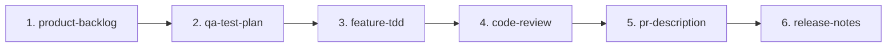

# Walkthrough: one feature, idea to release

This is what the toolkit produces for one real feature of Marito Detailing: **a customer reschedules an appointment**. Each section is the output of one agent, trimmed for length, in the order the work happens.

> The real project writes these in Spanish, as its [`CLAUDE.md`](CLAUDE.md) sets. They are shown in English here.



---

## 1. `product-backlog`: the user story

> **Prompt:** use product-backlog to write the story "the customer can reschedule an appointment"

### KEY-58 Customer reschedules an appointment

**As a** customer
**I want** to move my appointment to another available slot
**so that** I don't have to cancel and book again when my plans change.

**Value:** fewer cancellations and fewer lost bookings when plans change.

#### Acceptance criteria
1. **Given** a confirmed appointment more than 24 h away **when** I pick a new available slot and confirm **then** the appointment shows the new date and time and the old slot becomes free.
2. **Given** an appointment less than 24 h away **when** I open it **then** the reschedule option is disabled and I see why.
3. **Given** another customer takes the slot while I am choosing **when** I confirm **then** I see "This slot was just taken" and my original appointment is unchanged.
4. **Given** an appointment I have already rescheduled twice **when** I try a third time **then** I am asked to contact support instead.
5. **Given** I reschedule **when** the change is saved **then** the assigned operator sees the new time without refreshing.

#### Edge cases
- Double tap on "Confirm" must not create two bookings.
- The new slot is shown and stored in the customer's time zone, including the day daylight saving changes.
- No network when confirming: nothing changes and the customer can retry.

| | |
|---|---|
| Touches the database | yes: `appointments` (update), customer RLS policy for updates |
| Dependencies | KEY-12 Cancel an appointment |
| Size | M |
| Suggested branch | `feature/KEY-58-reschedule-appointment` |

**Out of scope:** rescheduling by the operator, fees for late changes.

---

## 2. `qa-test-plan`: the test plan

> **Prompt:** use qa-test-plan to build the test plan for KEY-58

#### Traceability matrix
| Acceptance criterion | Test cases |
|---|---|
| AC1: reschedule more than 24 h away | QA-01, QA-02 |
| AC2: blocked within 24 h | QA-03 |
| AC3: slot taken at the same time | QA-04 |
| AC4: limit of two reschedules | QA-05 |
| AC5: operator sees the change live | QA-06 |
| Security: only the owner can reschedule | QA-07 |

#### Selected cases
| ID | Case | Type | Priority | Automatable |
|---|---|---|---|---|
| QA-01 | Reschedule to a free slot updates the appointment and frees the old one | functional | high | yes (unit) |
| QA-03 | Appointment 23 h 59 min away cannot be rescheduled | edge case | high | yes (unit) |
| QA-04 | Two customers confirm the same slot: only one wins, the other keeps the original | negative | high | yes (unit, fake repository) |
| QA-06 | Operator's list updates within 2 seconds | functional | medium | no (needs two devices) |
| QA-07 | Customer A cannot reschedule customer B's appointment through the API | permissions | high | yes (RLS test with each role) |

**Handed to automation (`create-unittest`):** QA-01, QA-02, QA-03, QA-04, QA-05, QA-07.

---

## 3. `feature-tdd`: built test-first

> **Prompt:** use feature-tdd to implement KEY-58

The agent works in red, green, refactor cycles, one acceptance criterion at a time. The first failing test it wrote:

```swift
func test_reschedule_lessThan24HoursAway_throwsTooLate() async {
    let appointment = Appointment.stub(startsAt: now.addingTimeInterval(23 * 3600))
    let sut = makeSUT(appointments: [appointment])

    await XCTAssertThrowsErrorAsync(
        try await sut.reschedule(appointment.id, to: .stub(startsAt: nextWeek))
    ) { error in
        XCTAssertEqual(error as? RescheduleError, .tooLate)
    }
}
```

Commits proposed by `git-commit-messages`, one per cycle:

```text
test: KEY-58 add reschedule use case tests
feat: KEY-58 add RescheduleAppointmentUseCase
db: KEY-58 add customer update policy for appointments
feat: KEY-58 add reschedule sheet to appointment detail
```

---

## 4. `code-review`: the review

> **Prompt:** use code-review to review the current branch before the PR

| Priority | Finding | Fix |
|---|---|---|
| 🔴 Blocker | The update policy checks `customer_id` but not the appointment state, so a completed appointment could be moved through the API | Add `status = 'confirmed'` to the RLS `using` clause and a test for it |
| 🟠 Important | Slot availability is checked in the app and then written, so two customers can win the same slot | Do the check and the update in one database function |
| 🟡 Minor | `RescheduleSheetView` formats dates with the device locale instead of the shared formatter | Use `AppDateFormatter.appointment` |

The blocker and the important finding were fixed, and a second review came back clean.

---

## 5. `pr-description`: the pull request

```text
feat: KEY-58 customers can reschedule an appointment
```

> **Why:** customers who changed plans had to cancel and book again, and many never came back to book.
>
> **Use cases:** customers can move a confirmed appointment more than 24 h away to another free slot, up to twice. Operators see the new time instantly.
>
> **Database and backend:** new script `database/023_reschedule_appointment.sql` adds the `reschedule_appointment` function and the customer update policy. Run it before releasing the app.
>
> **How to test:** book an appointment for next week, open it, tap "Reschedule" and pick another slot. Tests: `xcodebuild test -scheme DetailingCar ...`

Suggested labels: `feature`, `database`.

---

## 6. `release-notes`: what users read

```text
## 1.4.0

### New
- You can now reschedule an appointment up to 24 hours before it starts, right from the app

### Fixed
- Appointment dates now look the same on every screen
```

---

**Result:** one story, 5 acceptance criteria, 7 test cases (6 automated), one security blocker caught before merge, and release notes a customer understands. That is the whole point of the toolkit: every role works from the same story, and nothing ships untested.
